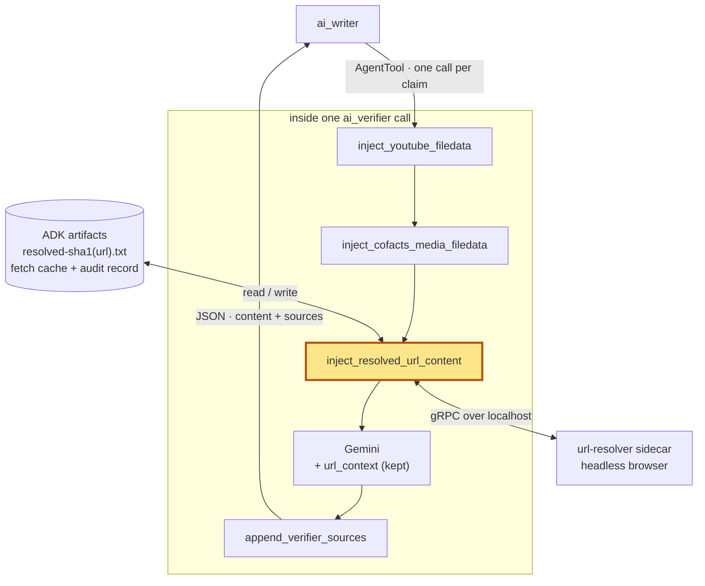
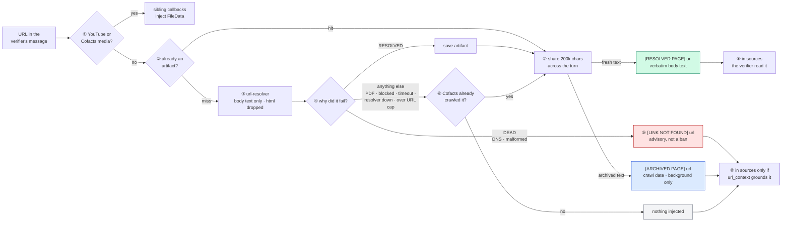

# Pre-fetch real page text for the verifier via url-resolver

## Context and Problem Statement

[`20260515-agent-source-integrity-contract`](20260515-agent-source-integrity-contract.md) made
the `ai_verifier` the single source of truth for "which URL backs which claim", and the writer
may only cite what the verifier marked ✓. That contract guarantees **provenance** — the writer
copies URLs instead of inventing them — but it does not guarantee the verifier **actually read
the page**. The verifier's only eyes are Gemini's built-in `url_context` tool, a black box: when
it silently returns nothing for a URL, nothing in the pipeline notices, and the model fills the
gap from training knowledge. The result is the failure mode the contract was supposed to end,
relocated one step upstream: a ✓ against a link that is dead, or that simply does not contain
the claim.

Three months of dogfooding feedback (Langfuse `user-thumbs`, 2026-04-22 → 2026-07-21: 130
ratings, 80 of them negative) put **27 reports — 20.8% of all feedback and 33.8% of downvotes —
in this one category**, making it the single largest complaint about the system and, in the
team's words, 「最高頻、最傷信任的問題」 (the most frequent and most trust-damaging problem).
Monthly share showed no improvement across the window (May 25%, June 17%, July 23%), i.e. the
prompt-level rules shipped in #55/#77 had not closed it.

Scope: the ADK verifier's perception layer only — `ai_verifier`'s `before_model_callback` chain
(`adk/cofacts_ai/resolved_pages.py`) and `after_model_callback` (`agent.py`), plus a new gRPC
client package and a new
internal service dependency ([`cofacts/url-resolver`](https://github.com/cofacts/url-resolver))
in the deploy topology. The writer, the investigator and the `claim_sources` gate are unchanged.
Driving PR: [cofacts/ai#118](https://github.com/cofacts/ai/pull/118).

### Langfuse evidence

- [Honey session `fcbe502f` / trace `93095969`](https://langfuse.cofacts.tw/project/cmm0emerr0001qi07eugd0760/traces/93095969a5b796d9555915dbdd014d99) —
  the clearest case. The fact-checker reported 「Verifier 被輸入四個錯的網址（都點不進去），結果
  verifier 幻覺說支持。」 The trace confirms it: `agent_run [verifier]` emitted
  `✓ **Supported**` for a PanSci article **together with a verbatim 「」 quotation** —
  manufactured wholesale, since the page it cites does not resolve. Analysis: the verifier does
  not merely guess when `url_context` comes back empty, it fabricates supporting evidence in the
  exact shape the output format asks for, which is indistinguishable from a real ✓ downstream.
  The same session was downvoted twice for the same cause
  ([trace `6ba8807d`](https://langfuse.cofacts.tw/project/cmm0emerr0001qi07eugd0760/traces/6ba8807db7391cb36fac1c26ac0fee8f),
  「這兩個不存在」).
- [Trace `1b430b76`](https://langfuse.cofacts.tw/project/cmm0emerr0001qi07eugd0760/traces/1b430b765b5152f9388fd2de3b1f1433)
  (session `889941dc`, 2026-05-15) — 「`heho.com.tw/archives/378892` 醫學專業網站：龍葵鹼中毒症狀與處理建議」是錯的，裡面沒有中毒症狀. Analysis: the second sub-mode — the URL is
  **live**, so no reachability check would catch it; the page simply lacks the claimed content.
  Fixing dead links alone is insufficient.
- [Trace `bd7188e5`](https://langfuse.cofacts.tw/project/cmm0emerr0001qi07eugd0760/traces/bd7188e56175010efdec09d4937a31a3)
  (session `1ae58e74`, 2026-06-24) — the fact-checker checked the cited book by hand: 「我翻找
  Things Chinese 這本書，裡面根本沒說 Four is an unlucky number 那句話。」
- [Trace `bfb7c047`](https://langfuse.cofacts.tw/project/cmm0emerr0001qi07eugd0760/traces/bfb7c047dc5542588c9fec584e950b56)
  (session `9d23432c`, 2026-07-06) — 「Verifier 胡謅」: a fabricated citation of a Hong Kong
  Legislative Council record, page number included.
- [Trace `8e672492`](https://langfuse.cofacts.tw/project/cmm0emerr0001qi07eugd0760/traces/8e672492da6cde37bf2dd09aa85ad10f)
  (session `eff1ce5b`, 2026-07-11) — 「我都貼了 privacy 他卻還在用不存在的
  `https://www.cmoney.tw/policy/privacy`」. Analysis: the model preferred a _plausible-looking_
  URL it had invented over the real one pasted into its own context.

The 2026-06-16 weekly review ([cofacts/kb](https://github.com/cofacts/kb)
`src/meetings/2026/20260616.md`) reached the same conclusion independently, tracing the chain
「investigator 搜尋出幻覺 URL，verifier 拿到壞 URL 後依然宣稱『支持』」 and stating the
requirement this record implements: 「對無法存取的 URL 不應產出「支持/反對」結論」.

## Decision Drivers

- A ✓ must be **evidence the page was read**, not a claim that it was. `url_context` returning
  nothing must be distinguishable from `url_context` returning support.
- Both sub-modes must be addressed: of the 27 reports, 11 carry a **dead-link** signal
  (「提供不存在的出處」/「瞎掰」) and 20 a **content-mismatch** signal
  (「出處摘要錯誤」/「回應文字與出處不符」/「胡謅」), with 4 carrying both. A reachability probe
  alone would leave the larger group untouched.
- The verifier's output format demands **verbatim quotes**, so whatever we feed it must be the
  page's real text, not a paraphrase — a summary layer would let an unsupported source read as
  supporting.
- `url_context` cannot simply be replaced: it is the only path to YouTube **video content** and
  page **metadata** (upload date, uploader), which url-resolver — an HTML scraper — cannot
  provide. Per the ADK constraint recorded in
  [`20260515`](20260515-agent-source-integrity-contract.md), a built-in tool cannot share an
  agent with function-calling tools, so anything added as a _tool_ would force `url_context` out.
- A fetcher failure must never be mistaken for proof that a URL is fake, or a resolver outage
  would brand good sources dead and silently degrade verification.
- Keep the verifier a **verifier**: the fix belongs at the confirmation gate, not spread across
  the pipeline.
- LLM context and cost must stay bounded, and the raw HTML url-resolver returns (100 KB+ per
  page) must never reach a model.

## Considered Options

Reconstructed from the design discussion on #118 (the maintainer proposed the first three
placements; the fourth emerged in review):

- **url-resolver as a general tool** — expose it to the pipeline as a function tool.
- **url-resolver as the verifier's tool** — the verifier decides which URLs to read.
- **Pre-resolution in a `before_model_callback`** — the system fetches every plain web URL
  before the verifier's model call and injects the cleaned text. **Chosen.**
- **A dedicated resolver sub-agent behind `AgentTool`** — isolate fetching and summarizing in
  its own agent so bulk text never enters the orchestrator's context.

## Decision Outcome

Chosen option: **pre-resolution in a `before_model_callback`, keeping `url_context`**, because
it is the only option that makes reading **non-optional**. The real page text is already in the
verifier's context before it produces a token, so there is no code path in which it "forgets" to
read and falls back to training knowledge — which is precisely how the two tool-shaped options
fail: a tool the model may skip is a tool the model will sometimes skip, and that is the bug. A
callback is not a tool, so it also sidesteps the ADK built-in-tool constraint entirely and lets
`url_context` stay for video and metadata. The sub-agent option was rejected as a _fix_ (it
isolates context nicely but leaves the verifier reading through the same black box) and is
retained only as a possible future writer-side convenience.

### Where the hook sits

`inject_resolved_url_content` is a third `before_model_callback` on `ai_verifier`, alongside the
two that already inject media. Being a callback rather than a tool is the whole point: it runs
between the request being assembled and Gemini seeing it, so the page text is in context before
the model produces a token. There is no branch in which the model "skips the tool".

### What it does to the content

Each URL in the verifier's message passes through the decisions numbered in the diagram; the
subsections below take them in the same order. A URL ends as one of four things in the request
— fresh page text, an advisory "not found" note, an archived copy, or nothing — and the
right-hand column shows what each can become in `sources`.

#### ① Only plain web URLs

YouTube URLs and Cofacts `gs://` media are left to `inject_youtube_filedata` and
`inject_cofacts_media_filedata`, which hand Gemini the media itself as `FileData`. url-resolver
scrapes HTML text, so it has nothing to add for a video. Everything else that looks like an
http(s) URL (CJK-aware extraction) goes on.

#### ② The artifact store is the fetch cache

Page text is saved as `resolved-<sha1(url)>.txt`. One file serves three purposes: the cache
that saves re-fetching on the verifier's ~2 model calls per turn and on later turns of the
session; the full text when ⑦ had to trim the injected copy; and, since the frontend already
renders artifacts, a record a human can audit of exactly what the system read. Only resolved
text is cached. A failure costs little to retry, so it is not stored.

Every model call re-injects the page, because ADK rebuilds `llm_request.contents` from session
events and parts appended to the request are gone by the next call. The cache stops that from
costing a re-fetch, but the tokens are still re-sent.

#### ③ url-resolver returns body text, never HTML

The gRPC client (`adk/cofacts_ai/url_resolver/`) drops `html` unconditionally. That is the
one rule in the module that cannot bend: raw HTML is 100 KB+ per page and must never reach a
model. Replies are joined back to requests **by URL**, because stream order is not guaranteed.
At most `URL_RESOLVER_MAX_URLS` URLs are sent per call. The one shared deadline grows with the
number of URLs sent (`DEFAULT_PER_URL_TIMEOUT` each, never below 30 s) unless
`URL_RESOLVER_TIMEOUT` is set: a page without enough `<meta>` tags for url-resolver's
`parseMeta()` fast path pays for a real headless-browser navigation, so a flat 30 s for the
whole batch would let a few such pages time out the rest.

#### ④ Failures are split by cause, and only one cause means "bad link"

Only `NAME_NOT_RESOLVED` / `INVALID_URL` become `DEAD`: the URL itself is unusable. Every other
failure means _the resolver_ could not get the page, not that the page is missing. That covers
`UNSUPPORTED` (a PDF), `NOT_REACHABLE`, `HTTPS_ERROR`, scrap/unfurl errors, a stream that ends
before answering (`TIMEOUT`), a whole-call failure (`RESOLVER_UNAVAILABLE`, set on every URL)
and a URL past the cap (`NOT_ATTEMPTED`). A resolver outage must never mark good sources as
dead. That is why the split is by cause and not simply success/failure.

The client keeps those causes apart (as `ResolveStatus` values), so logs and tests can tell
a capped batch from a slow resolver. The callback does not: past this diamond, every cause
except `DEAD` takes the same path. An earlier revision gave each cause its own note
(`[NOTE] couldn't fetch`, `[NOT PRE-FETCHED]`, silence for a timeout), but every one of those
notes told the verifier the same thing — use `url_context`, which it must call for every URL
anyway. So the notes added prompt surface without changing behaviour, and a resolver hiccup
spelled out to the model risked being read as evidence against the link. The cap is still
visible, in a warning log.

#### ⑤ `[LINK NOT FOUND]` is advisory, not a ban

The note tells the verifier to try `url_context` anyway, and to withhold support only if that
_also_ retrieves nothing: url-resolver's simpler fetch failing does not prove the page does not
exist. `DEAD` deliberately skips ⑥. Pairing "this link is broken" with the text it served
years ago invites the very citation the note exists to prevent.

#### ⑥ Cofacts' own earlier crawl is the fallback

Added in [#136](https://github.com/cofacts/ai/pull/136). An article or reply already carries
`hyperlinks`: page text Cofacts' url-resolver crawled when the message came in — the same
service and the same `summary` field, only fetched earlier. When the live fetch gives no
signal, that copy is injected as `[ARCHIVED PAGE]`; with no copy, nothing is injected and
`url_context` gets a clean shot at the URL. Three things keep this from re-running the problem
this record exists to fix:

- **It is never a source.** It is left out of `temp:cofacts_resolved_meta`, which is what ⑧
  turns into `sources`. The verifier may read the text, but nobody may cite a page that nobody
  could fetch this turn.
- **It is dated in the prompt.** Without `fetchedAt` the copy cannot be interpreted, and the
  date cannot be inferred from the article: 2016 articles carry hyperlinks backfilled in 2018.
- **The prompt ranks it last.** It is background for understanding what the link was about,
  and `url_context` wins wherever the two disagree.

**How the copy reaches the verifier.** The hyperlinks live in the writer's session, in the
`function_response` events of its two Cofacts tools. The verifier runs in a separate child
session that `AgentTool` creates for every call. So the data has to cross that boundary, and
it rides in the verifier's `request` (`adk/cofacts_ai/archived_pages.py`):

- `stage_archived_links`, a writer `before_tool_callback` placed after `resolve_citations`,
  walks the writer's events. It keeps the hyperlinks whose URL the request mentions, and appends
  them to the request as a JSON block. `_citable_index` already walks the same events to resolve
  citations. ADK hands callbacks a deep copy of the call's arguments, so the block never enters
  the writer's own history.
- `unpack_archived_links`, the verifier's **first** `before_model_callback`, parses the block
  into `temp:cofacts_archived_links` and removes it from the request. That way the model only
  ever sees archived text framed as `[ARCHIVED PAGE]`, and the URL-reading callbacks after it
  never pick up URLs from inside archived pages. `temp:` is right on this side, because writer
  and reader share one child session.
- The block's tag carries a per-process random suffix. The suspicious message is quoted into
  the request verbatim, and it must not be able to forge a block and supply "archived" text of
  its choosing.

Options considered for the hand-off:

- **`temp:` state in the writer**, as first shipped in #136. **It never worked.** `AgentTool`
  seeds the child session through `create_session(state=...)`, which drops every `temp:` key,
  and `temp:` is not persisted across turns either. Every unit test built the verifier's state
  by hand, so none of them noticed. This is the same trap
  [`20260603-auth-token-contextvar`](20260603-auth-token-contextvar.md) records for the auth
  token.
- **Non-`temp:` state.** It would cross the boundary, but every write is persisted in the
  event's `state_delta`. Whole page texts would pile up in the session database on every
  Cofacts call.
- **A `ContextVar` set in the writer's `before_tool`.** This works, because ADK runs each
  function call, and the `AgentTool` child inside it, in one asyncio task. But it depends on that
  execution detail, and nothing a reader can see shows what was carried.
- **Re-saving hyperlinks as artifacts**, beside `resolved-<sha1>.txt`. This keeps the verifier
  side simplest: a lookup on failure. But it duplicates what session events already hold, and
  it pays a write, plus a read to avoid piling up versions, for every hyperlink of every Cofacts
  call. Most of those are never needed, because the live fetch usually succeeds.
  `resolved-<sha1>.txt` earns its artifact because the session holds that text nowhere else.
- **In the request: chosen.** The cost is paid only when the verifier is called, and only for
  the URLs it is asked about. There is one copy of the data, and the hand-off shows up in the
  tool call's trace. Both ends are plain functions. A test runs them through a real `AgentTool`,
  which is the boundary that broke the first version.

Deliberately **not** done: skipping the live fetch when Cofacts' copy is fresh. The verifier's
question is whether the link supports the claim _now_. The cost is real (the re-fetch also
spends the URL cap on pages that already have text), and `fetchedAt` is what a future policy
would weigh.

#### ⑦ Raw text, budgeted across the turn

Fresh and archived pages are injected **in full** while their combined length fits
`URL_RESOLVER_TOTAL_CHAR_BUDGET` (default 200 000 chars). Only on overflow does a max-min fair
split (`_water_fill`) trim the longest pages, leaving short ones whole. Text is never
summarized, because the verifier must quote verbatim and a summary could make an unsupported
source read as supporting. A malformed budget raises instead of quietly turning the feature
off.

#### ⑧ `sources` is a union, so no ban list is needed

`append_verifier_sources` (replacing `append_url_context_sources`) unions the pages url-resolver
resolved with `url_context`'s grounding chunks. A dead URL is fetched by neither path, so it is
simply absent and can never reach the `claim_sources` gate. A PDF url-resolver missed but
`url_context` grounded still appears. Archived text adds nothing to the union, even though the
model read it. The callback writes the resolved half to `temp:cofacts_resolved_meta` and
clears it first on every model call. `temp:` already keeps it inside one verifier call:
`AgentTool` seeds the child session without `temp:` keys, and the deltas it forwards back are
trimmed of them. But one verifier call makes ~2 model calls in the same child session, so
without the reset a later call that exits early would keep the earlier call's meta. `sources`
would then list pages missing from the request the final answer was written from. The union also wraps the response when `url_context`
returned no grounding at all, so a model that skips it does not lose the fetched sources too.

### Around the hook

- **Prompt.** The verifier takes body text from `[RESOLVED PAGE]` and metadata, upload dates
  and video content from `url_context`, whose must-call rule is kept. Each injected marker
  (`[RESOLVED PAGE]`, `[LINK NOT FOUND]`, `[ARCHIVED PAGE]`) has its own rule, and a URL with
  none of them is described as "fall back to url_context".
- **Generated stubs are committed.** The `.proto` files are vendored from `cofacts/url-resolver`
  and `adk/scripts/gen_protos.sh` output is checked in, so the runtime image needs `grpcio` but
  not `grpcio-tools`.
- **Internal-only deployment.** url-resolver is insecure gRPC with no auth and is never exposed:
  in production it shares the docker-compose network (`URL_RESOLVER_ADDRESS=url-resolver:4000`),
  and on Cloud Run it runs as an adk sidecar over `localhost`.
- **No investigator-side pre-screen.** Several bad URLs come from the investigator, but the
  architecture makes the verifier the gate ("INVESTIGATOR DISCOVERS, VERIFIER CONFIRMS"), so
  catching them there covers those downstream and keeps each agent's role intact.

### Consequences

- Good, because reading is no longer optional: the verifier cannot produce a ✓ for a page whose
  text was never in its context, which removes the mechanism behind the fabricated-quote case
  above.
- Good, because it addresses **both** sub-modes with one change — dead links surface as
  `[LINK NOT FOUND]`, and live-but-irrelevant pages are exposed by having their real text present
  for the model to fail to find the claim in.
- Good, because a dead URL is now excluded from `sources` **structurally**, by not being fetched,
  rather than by a rule someone must maintain.
- Good, because the failure taxonomy degrades safely in both directions: a resolver outage falls
  back to today's behaviour instead of mass-marking sources dead, and a resolver limitation (PDF)
  hands the URL to `url_context` instead of suppressing it — and, since #136, to Cofacts' own
  earlier crawl of the same page before that.
- Good, because the fallback reuses data the pipeline already fetched. `hyperlinks` was being
  requested and discarded; the only new cost is one extra GraphQL field.
- Bad, because `[ARCHIVED PAGE]` puts text in front of the model that is true of the past and
  may be false of the present. The marker, the stated crawl date and the prompt rule are the
  whole defence, and they are instructions to a model rather than a structural guarantee — the
  structural part is only that the text cannot become a `source`.
- Good, because the cached full text gives fact-checkers and future debugging a record of what
  the system actually read — the artifact is evidence, not just a cache.
- Bad, because every page is now fetched **twice** (url-resolver's puppeteer and Gemini's
  `url_context`), adding latency and load; url-resolver re-scrapes per call with a 5 s per-URL
  fetch timeout, so a 20-URL batch can develop a long tail.
- Bad, because the ADK backend gains a **runtime dependency on another service**. It degrades
  gracefully, but when url-resolver is down the anti-hallucination guarantee silently reverts to
  the old `url_context`-only behaviour — the pipeline is quieter about this than an outage
  deserves.
- Bad, because head-truncation is naive: on an over-budget batch the trimmed tail of a long
  article is invisible to the verifier, which could turn a supported claim into a ✗. Claim-aware
  windowing is the intended upgrade if this bites.
- Bad, because the resolver-result handoff to `append_verifier_sources` travels through
  `temp:` session state. The after-model callback receives only the `LlmResponse` and cannot see
  the request it was built from, so the two halves of the `sources` union are necessarily
  computed at different times and stitched through state — another private convention in the
  same family as the `{content, sources}` contract.
- Bad, because the archived-copy hand-off is a private format shared by two callbacks: the
  writer appends a tagged block to the verifier's `request`, and the verifier must strip it
  before anything reads the text. A third callback that reads the request ahead of
  `unpack_archived_links` would see raw archived text. The callback order in `agent.py` and
  the AgentTool test are what hold that line.
- Bad, because injected page text still competes for attention: it is bounded, but a 200 000-char
  turn is real cost and real mid-context recall risk.

## Confirmation

- Unit tests, network-free by faking the gRPC channel/stub and the artifact store. They pin the
  invariants that matter rather than the implementation: `html` never leaves the client; results
  join by URL, not stream order; each `ResolveError` value lands in the right bucket; a transport
  failure marks every URL `RESOLVER_UNAVAILABLE` and **never** `DEAD`; `RESOLVER_CANT_FETCH`
  injects nothing; a misconfigured char budget raises rather than degrading to url_context-only;
  the second model call of a turn re-injects the page but is served from the artifact cache, not
  the network; a dead URL never appears in `sources` while a `url_context`-grounded PDF still
  does; a URL dropped by `URL_RESOLVER_MAX_URLS` becomes `NOT_ATTEMPTED` rather than vanishing
  (including when it coincides with a whole-call `RESOLVER_UNAVAILABLE` failure), the timeout
  scales with the number of URLs actually sent (not the pre-cap count) unless
  `URL_RESOLVER_TIMEOUT` is set, and every non-`DEAD` failure injects an archived copy when
  Cofacts has one and nothing otherwise.
- The archived-copy hand-off is tested end to end through a real `AgentTool`, with a scripted
  model on both sides. A hyperlink in an earlier turn's Cofacts response reaches the verifier as
  `[ARCHIVED PAGE]`, and the staged block never reaches the verifier's model. Swapping in the
  old `temp:` hand-off makes the test fail.
- `ruff check`, `ruff format --check` and `ty check` clean; protoc-generated stubs are excluded
  from both via `pyproject.toml`.
- The end-to-end check against a live resolver is done, against #123's real preview deployment
  (Cloudflare Browser Rendering backend) rather than local Docker: a real CNA news URL resolved
  via url-resolver's `parseMeta()` fast path (plain HTTP, matching the page's own
  `<meta name="description">` exactly) without ever reaching the browser, while a URL that
  structurally cannot satisfy that fast path (a Wikipedia article — no meta description, no
  `og:description`) did exercise the real Puppeteer/Cloudflare `scrap()` path and returned full
  Readability-extracted body text (16.5k chars, correct enough that the verifier caught a
  deliberately-wrong claim in a test message). Traces:
  [CNA / fast path](https://langfuse.cofacts.tw/project/cmm0emerr0001qi07eugd0760/traces/d11d76db142bf9fb26019ef398eb4d16),
  [Wikipedia / real browser path](https://langfuse.cofacts.tw/project/cmm0emerr0001qi07eugd0760/traces/c0914364409e974baf4eeb6fac680715).
- The real measure is the feedback rate this record opens with: the share of `user-thumbs`
  downvotes citing 「提供不存在的出處」/「出處摘要錯誤」/「回應文字與出處不符」 should fall from
  its ~34% baseline. That is only observable in production over weeks, and is the reason this
  record stays `proposed` until #118 merges and the numbers move.

## More Information

- Implemented in [cofacts/ai#118](https://github.com/cofacts/ai/pull/118) — open as a draft at
  the time of writing, hence `status: proposed`. Update to `accepted` on merge.
- This record **extends** [`20260515-agent-source-integrity-contract`](20260515-agent-source-integrity-contract.md)
  rather than superseding it: that contract's provenance guarantee, discover-vs-confirm roles and
  `claim_sources` gate all stand unchanged. What changes is the verifier's evidence base — and
  one name from it, `append_url_context_sources`, which is now `append_verifier_sources`.
- It reuses the callback-injection pattern established by
  [`20260531-callback-media-injection`](20260531-callback-media-injection.md) and generalized in
  [`20260606-multimodal-perception-vertex-ai`](20260606-multimodal-perception-vertex-ai.md);
  `inject_resolved_url_content` is the third callback in the same chain and deliberately excludes
  the URL shapes those two own.
- Evidence and analysis: the Langfuse traces above, and the Cofacts weekly reviews in
  [cofacts/kb](https://github.com/cofacts/kb) `src/meetings/2026/` — `20260616.md` (the
  investigator→verifier hallucination chain and the requirement quoted above), with earlier
  instances in `20260515.md`, `20260602.md` and `20260609.md`.
- Revisit if: the double fetch proves too slow (drop `url_context` for non-video URLs and build
  `sources` from the resolver alone); truncation loses relevant passages (claim-aware windowing);
  or bad URLs are better killed at the source (an investigator-side pre-screen, deliberately out
  of scope here).
