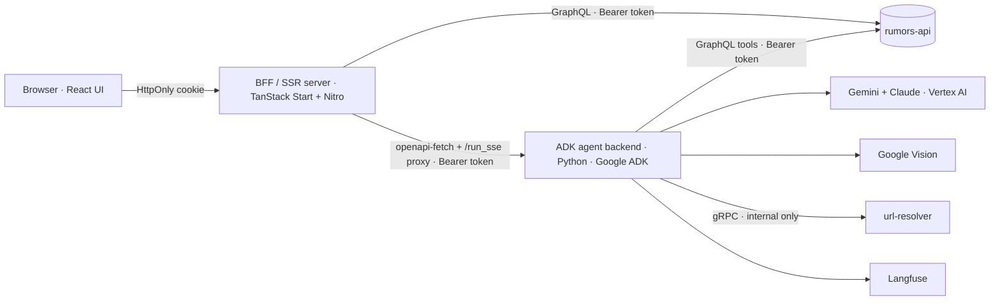

# Cofacts.ai — architecture overview

Cofacts.ai is a chat-based AI assistant for **collaborative fact-checking**. It helps human
fact-checkers (it does not replace them) triage suspicious messages reported to Cofacts,
research and verify claims, and draft fact-check replies. It builds on the existing Cofacts
`rumors-api` (article data + OAuth login), Google Gemini and Anthropic Claude via Vertex AI
(the agents), and Langfuse (observability + feedback).

This page is the **current-state overview**. The _why_ behind each choice lives in
[`decisions/`](decisions/index.md) as MADRs — this page links out to them rather than
repeating them. See [`AGENTS.md`](../AGENTS.md) for how to keep both up to date.

## Two services

1. **Frontend + BFF** — a TanStack Start (React / Vite / Nitro) app at the repo root
   (`src/`). The browser talks _only_ to the BFF (server functions + `/api/*` routes). Auth
   is an HttpOnly `cofacts_session` cookie — the JWT never reaches browser JavaScript. The
   BFF proxies to the ADK backend and to `rumors-api`.
   → decision: [BFF auth](decisions/20260509-bff-auth-httponly-cookie.md).
2. **ADK agent backend** — a self-contained Python Google-ADK project under `adk/` (its own
   `pyproject.toml` / `Dockerfile`). A hierarchical multi-agent system (see below).

## How it starts

- **Dev:** `pnpm dev` runs both services with `concurrently` — the UI+BFF via `vite dev`
  (`:3000`) and the ADK backend via `uvicorn main:app` (`:8000`, API docs at `/docs`).
  One-time setup: `pnpm install`, then `pnpm install:agent` (`uv sync`), plus
  `gcloud auth application-default login` for Vertex AI. Two env files: root `.env`
  (browser/BFF) and `adk/cofacts_ai/.env` (agent).
- **Prod:** a single **Cloud Run** service with four containers — `ingress` (frontend/BFF),
  `backend` (ADK), `cloudsql-proxy`, and `url-resolver` — defined by `service.template.yaml`
  and deployed by `.github/workflows/deploy.yml`. Containers talk over `localhost`, which is
  also what keeps the unauthenticated `url-resolver` gRPC endpoint off the network.
  `url-resolver`'s headless browser does not run in that container: `BROWSER_BACKEND` is
  pinned to Cloudflare Browser Rendering, which is what lets the sidecar hold 0.5 vCPU /
  512 MiB. It needs the `CLOUDFLARE_ACCOUNT_ID` / `CLOUDFLARE_API_TOKEN` repo secrets.
  The `ingress` image also serves the built Storybook at `/storybook/`.
  → decisions: [Cloud Run multi-container deploy](decisions/20260303-cloud-run-multi-container-deploy.md),
  [url-resolver Cloud Run sidecar](decisions/20260828-url-resolver-sidecar-browser-backend.md),
  [Postgres session persistence](decisions/20260506-postgres-session-persistence.md),
  [verifier page pre-fetch](decisions/20260722-url-resolver-verifier-prefetch.md),
  [Storybook in the frontend image](decisions/20261014-serve-storybook-from-frontend-image.md).

## The ADK multi-agent system

The root agent is **`ai_writer`**, the orchestrator that composes fact-check replies. It
invokes sub-agents wrapped as ADK `AgentTool`s (the writer cannot call built-in tools such as
`google_search` / `url_context` alongside function tools in a single agent):

| Agent                                        | Role                                                                                                                                                                     |
| -------------------------------------------- | ------------------------------------------------------------------------------------------------------------------------------------------------------------------------ |
| `ai_writer`                                  | Orchestrator. Triages, extracts claims, coordinates research + verification, drafts the reply. Runs on **Claude Haiku**; text-only.                                      |
| `ai_investigator`                            | **Discovers** candidate sources via `google_search`.                                                                                                                     |
| `ai_verifier`                                | **Confirms** which source backs which claim, from page text pre-fetched via `url-resolver` plus `url_context`; the only agent that perceives **images / video / audio**. |
| `ai_proofreader_{kmt,dpp,tpp,minor_parties}` | Role-play Taiwan political perspectives to test the reply's neutrality.                                                                                                  |

The `ai_` prefix is only the Python variable name in `adk/cofacts_ai/agent.py`; the ADK runtime
names — the `name=` strings, mirrored in `src/lib/adk.ts` — drop it: `writer`, `investigator`,
`verifier`, `proofreader_*`.

The writer runs on Claude Haiku (`claude-haiku-5-5`) through ADK's `Claude` adapter on Vertex
AI; every other agent runs on Gemini. Agents exchange data through callbacks in
`adk/cofacts_ai/agent.py` (a structured `{content, sources}` JSON contract), and media is
injected as Gemini `FileData` into the verifier by before-model callbacks in
`adk/cofacts_ai/media_filedata.py` and `agent.py`. The same callback chain pre-fetches web pages
for the verifier (`adk/cofacts_ai/resolved_pages.py`) through the internal **url-resolver** gRPC
service (`adk/cofacts_ai/url_resolver/`), so its verdicts rest on page text the system actually
read. The writer never sees media: it forwards the article's `gs://` `attachmentUrl` to the
verifier, and `adk/cofacts_ai/writer_request.py` turns any media part left in its own request
(e.g. a user upload) into a text placeholder, since the Claude adapter cannot carry `FileData`;
it also serializes each tool result whole, since the adapter would otherwise forward only a
result's `content` and drop its `sources` / `cite_as`.
The placeholder keeps an upload's `gs://` URI, which the writer forwards to the verifier like an
`attachmentUrl`. The verifier attaches it only if the URI appears verbatim as the canonical URI
of one of the chat session's own `user-upload-*` artifacts (any version), with that artifact's
stored MIME type: its callback lists artifacts through its callback context, and `AgentTool`
gives the sub-agent ADK's `ForwardingArtifactService`, which answers for the calling writer
session. So a `gs://` string for another session or bucket is never attached (the Vertex AI
service agent can read every bucket in the project), and nothing is passed through session
state. The verifier's instruction forbids describing media that was not actually attached.

Each `AgentTool` call is a **fresh, stateless, single-message session** — a sub-agent sees only
that call's `request` string. So every tool result is stamped with a footnote id (`cite_as`, e.g.
`[^verifier-ygxikp2o]`), and writing that id in a sub-agent's `request` hoists the result's full
text to the top of the request as a block tagged with the same id — both halves in
`adk/cofacts_ai/writer_citations.py`, one in an after-tool callback and one in a before-tool
callback.
→ decisions:
[source-integrity contract](decisions/20260515-agent-source-integrity-contract.md),
[footnote citations for stateless sub-agent calls](decisions/20260722-subagent-context-citations.md),
[verifier page pre-fetch](decisions/20260722-url-resolver-verifier-prefetch.md),
[media injection via callbacks](decisions/20260531-callback-media-injection.md),
[multimodal perception on Vertex AI](decisions/20260606-multimodal-perception-vertex-ai.md),
[writer on Claude Haiku](decisions/20261021-writer-on-claude-haiku.md),
[auth token via ContextVar](decisions/20260603-auth-token-contextvar.md).

## Frontend design system

The UI follows the Penpot file **Cofacts-2026** and the designer's accessibility guide. The
`cofacts-frontend` skill (`.agents/skills/cofacts-frontend/`) holds the working rules: token →
class mapping, Penpot MCP recipes, accessibility, file layout, and the data layer. This section
is only the overview.

- **Tokens:** `design/tokens.json` (exported from Penpot) is the source. `pnpm tokens` generates
  `src/styles/tokens.css` (CSS variables + Tailwind `@theme`), `src/styles/tokens.generated.ts`
  (names for `cn()`'s tailwind-merge, lists for Storybook) and the skill's `references/tokens.md`.
  CI runs `pnpm tokens:check`. Class = token name without its role prefix
  (`surface-raised` → `bg-raised`, `type-body-m` → `text-body-m`); spacing is 1px per unit;
  Tailwind's default palette and sizes are switched off.
- **Themes:** semantic tokens flip between light and dark by `prefers-color-scheme`, overridable
  with `<html data-theme>`. Components never use `dark:`.
- **Global CSS:** `src/styles/global.css` holds only site-wide rules (tokens, body base, the
  focus ring).
- **Transition:** Storybook (Foundations/Tokens) already uses the new system; the app still
  loads the old `src/styles.css` until its components are replaced.
- **Data:** the browser never calls rumors-api; route files define server functions, and data
  flows through the TanStack Query cache (see the skill's `references/data-layer.md`).

Design record: the kb doc
[Phase 3 網站遷移與前端架構](https://github.com/cofacts/kb/blob/main/src/technical-design/cofacts.ai/Phase%203%20網站遷移與前端架構.md).

## Data & sessions

ADK sessions are persisted with `DatabaseSessionService` — SQLite locally, PostgreSQL via the
Cloud SQL proxy in prod. Production (GCE) uses the `adk` database; every Cloud Run deploy
(dev.cofacts.ai and PR previews) uses `adk_staging` on the same instance, a clone of production:
the `DATABASE_URL` secret those deploys read points at it. Chat artifacts (e.g. the
Google-search suggestion widget, uploaded files) are stored in GCS.
→ decisions: [Postgres session persistence](decisions/20260506-postgres-session-persistence.md),
[writer on Claude Haiku](decisions/20261021-writer-on-claude-haiku.md).

## Observability

Every model turn is traced to **Langfuse**; thumbs-up/down feedback is written back as
Langfuse scores (the secret key stays server-side, proxied through the BFF). Trace-driven
debugging is the team's standard workflow — most decisions here cite the trace that exposed
the problem.

## Invariant

`src/lib/adk.ts` (`AllTools`, the frontend's tool-name → args/response map) must be kept in
**strict sync** with `adk/cofacts_ai/tools.py` and `agent.py`. Changing a tool's shape means
changing both.
